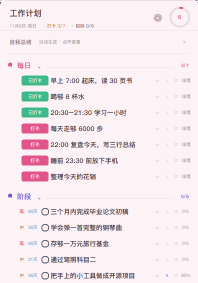
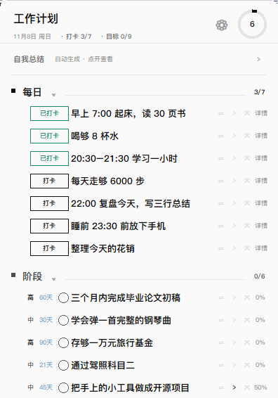
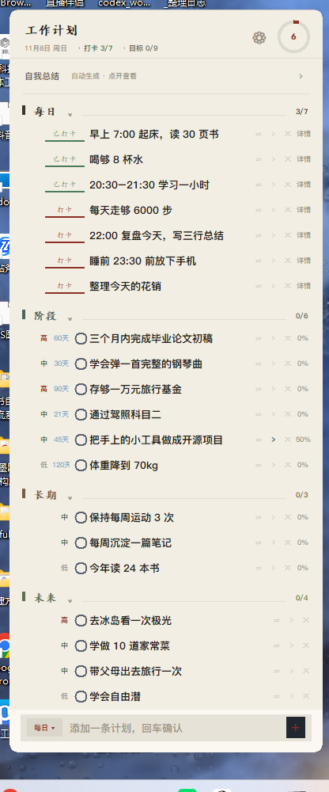
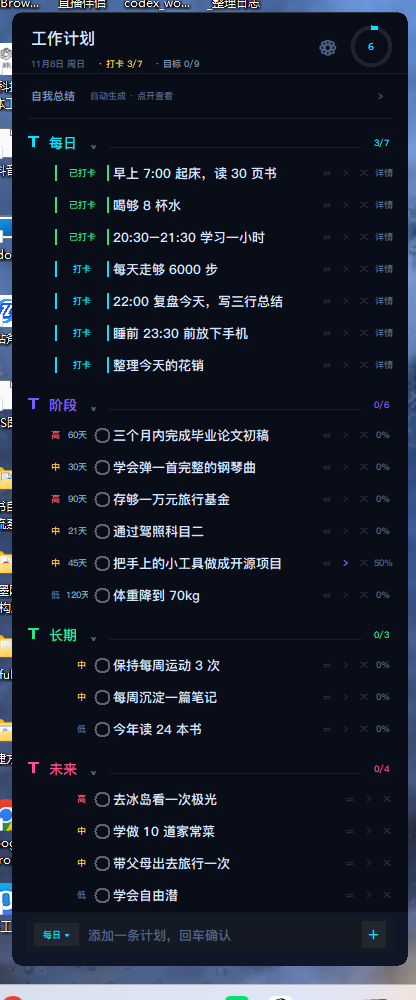
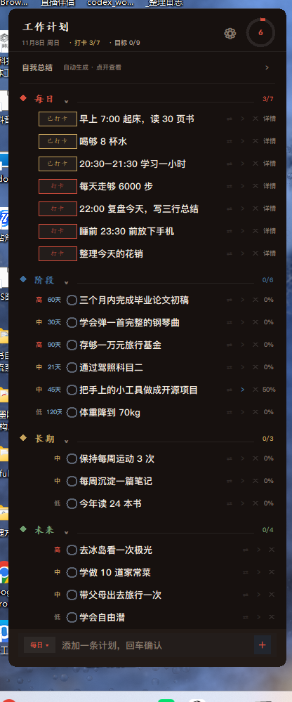
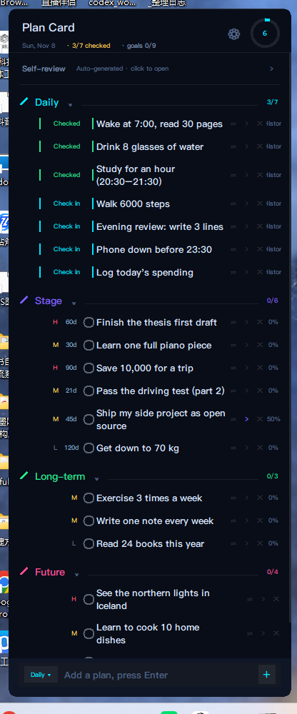

<div align="center">

# desktop-plan-widget 桌面部件小计划

**A Windows desktop plan widget — frameless, always visible on your wallpaper,
never covers your work.**


*Five themes — only the palette, fonts and button shapes change, never the layout.*

[Quick start](#quick-start) · [Why](#why-this-exists) · [Sections](#the-four-sections) · [Themes](#themes) · [Docs](#docs) · [中文](#中文)

</div>

---

## Why this exists

Your plan is usually in an app you have to *remember to open*. That makes it the
last thing you look at, not the first.

Plan Card is the opposite bet: **make the plan impossible to miss, and impossible
to be annoyed by.** It sits on the wallpaper, below every other window — no title
bar, no taskbar entry, no notification. You see it in passing, and nothing is
blocked.

It is deliberately **not** a task manager: no projects, no tags, no reminders, no
account. Four kinds of plans, one JSON file, done.

## Quick start

```powershell
git clone https://github.com/1072699644-cell/desktop-plan-widget.git
cd desktop-plan-widget
python plan_card.pyw
```

No `pip install` — standard library only, so a stock **Python 3.8+** on **Windows
10/11** is all you need. Prefer no terminal? Download the ZIP and double-click
**`plan_card.pyw`**.

First launch seeds sample plans (English or Chinese, matching your system
language) so the card isn't empty. Data lands in `plan_data.json` next to the
script; delete it to start over.

## The four sections

They are separate because they *behave* differently — that's the whole design.

| | Section | For | Behaviour |
|:-:|---|---|---|
| 🟡 | **Daily** | today's habits | one **Check in** button per row; the list resets each morning, the history doesn't |
| 🔵 | **Stage** | goals with a deadline | click the date chip → calendar; the row shows `12d` / `Today` / `3d late` |
| 🟣 | **Long-term** | ongoing things | progress percentage |
| 🟢 | **Future** | someday / maybe | a plain list, no percentages |

Only Stage and Long-term — the two with a percentage — count towards the progress
ring. Daily is a check-in routine; Future is a parking lot.

## What makes it different

| | Plan Card | Task app | Rainmeter skin | Sticky note |
|---|:---:|:---:|:---:|:---:|
| Visible without opening anything | ✅ | ❌ | ✅ | ✅ |
| Never covers your windows | ✅ | — | depends | ❌ |
| Four plan types, each with its own logic | ✅ | ✅ | ❌ | ❌ |
| Runs on a stock Python, no install | ✅ | ❌ | ❌ | — |
| Check-in history / streaks / auto self-review | ✅ | ✅ | ❌ | ❌ |
| Data in one local file | ✅ | ❌ | ✅ | ✅ |

## Features

**Planning**
- Daily check-in with memory: every click is recorded, so you get a streak and a
  30-day rate. Open **History** on a row for the last 14 days, day by day.
- Calendar deadline picker for stage goals — no typing dates, ever.
- Sub-tasks (click `›`), per-item priority, drag to reorder.
- Move any plan between sections: `⇄` menu, or drag the row onto the other one.
- Fold a section by clicking its name; the state is remembered.

**Overview**
- Auto self-review at the top — collapsed to one line, click to expand. Days
  logged, check-ins, daily average, best streak, goal progress. Switch
  Day / Week / Month. You never write it.
- Progress ring, per-section counters, a thin scroll indicator when needed.
- The input box is always pinned to the bottom — it can never be pushed off.

**Looks**
- Five themes that change **fonts, button shapes and section markers**, not just
  colours (see below).
- Opacity from 30 % to 100 %, adjustable live.
- Renameable title.

**Engineering**
- Zero third-party dependencies; one `.pyw` plus a small `tools/` folder.
- Data in a single JSON file — no account, no sync, no telemetry, no network code.
- Bilingual UI (Chinese / English) that follows the system language.
- Crash log only (`plan_card.log`); nothing is uploaded anywhere.

## Everyday controls

| Action | How |
|---|---|
| Add a plan | type in the bottom box, press `Enter` |
| Pick the target section | click the small chip left of the input box |
| Check in (daily) | click **Check in** |
| Edit text | **double-click** the row |
| Delete | `✕` at the right (appears on hover) |
| Reorder / move | drag a row, or `⇄` to switch section |
| Sub-tasks | `›` at the right |
| Deadline (stage) | click the `date` chip → calendar |
| Settings | ⚙ at the top right |

## Themes

Each theme also swaps the font, the button shape and the section marker — a
palette change alone would just look like the same app in a different colour.

| | Theme | Palette | Buttons | Markers |
|:-:|---|---|---|---|
| 🍬 | **Cute** | pale pink, pastel | rounded filled pill | circle |
| ⬜ | **Minimal** | near-white, greyscale | 1 px square outline | small square |
| 🖌 | **Ink** | rice paper, 楷体 | text + a brush stroke | vertical bar |
| ⚡ | **Tech** | deep navy, neon | double brackets `│x│` | diagonal tick |
| 🏮 | **Chinese** | dark lacquer, 国色 | seal box | diamond |

| Cute | Minimal | Ink |
|:---:|:---:|:---:|
|  |  |  |

| Tech | Chinese | English UI |
|:---:|:---:|:---:|
|  |  |  |

## Good to know

- **Windows only.** The frameless, rounded, translucent window leans on Win32
  (`SetWindowRgn`, layered windows), so macOS and Linux are out of scope.
- **Not a task manager.** If you need projects, tags, sharing or reminders this is
  the wrong tool — and that's intentional.
- **Data keys in the JSON are Chinese** (`每日` / `条目` / `完成`). Deliberate: it
  keeps existing files compatible across language switches. Only the interface is
  translated, through `tools/i18n.py`.
- **It doesn't install itself into autostart.** Add a shortcut to `shell:startup`
  if you want it at login — `docs/Usage.md` shows how.

## Docs

| | |
|---|---|
| [Usage](docs/Usage.md) | full English manual — every control, settings, troubleshooting |
| [使用说明](docs/使用说明.md) | 中文完整说明书 |
| [Architecture](docs/Architecture.md) | how it's built: Win32 window tricks, data model, check-in IDs, theme engine |
| [CONTRIBUTING](CONTRIBUTING.md) | add a theme, add a language, code layout |
| [CHANGELOG](CHANGELOG.md) | release notes |

## About

A small personal tool that got out of hand — it exists because my plans kept
dying in a notes app I had to remember to open.

- **One person, no company.** No team, no roadmap meetings, no analytics.
- **Local by design.** No account, no cloud, no telemetry, no network code.
- **Small on purpose.** Standard library only.
- **Feedback welcome.** Open an issue; I read all of them.
- **Contact.** 1072699644 `[at]` qq.com — issues are preferred for bugs and
  feature requests; email me for anything else.

⭐ If it saves you a minute a day, a star helps the next person find it.

## License

MIT — see [LICENSE](LICENSE).

---

<div align="center" id="中文">

# Plan Card · 桌面计划表

**一张贴在 Windows 桌面上的计划卡片——无边框、一直看得见、不挡任何窗口。**


[快速开始](#快速开始) · [四段计划](#四段计划) · [主题](#主题) · [完整说明](docs/使用说明.md)

</div>

### 为什么做这个

计划写在备忘录里，最尴尬的地方是——**你得先想起来打开它**。结果它永远是你一天里
最后才看一眼的东西，而不是最先看到的。

Plan Card 反过来：**让计划躲不开，又不烦人。** 它贴在壁纸上、沉在所有窗口下面，
没有标题栏、不占任务栏、不弹通知。你路过就看见，同时什么都不会被挡住。

它刻意**不是**一个任务管理器：没有项目、没有标签、没有提醒、没有账号。
四段计划，一个 JSON 文件，就这样。

### 快速开始

```powershell
git clone https://github.com/1072699644-cell/desktop-plan-widget.git
cd desktop-plan-widget
python plan_card.pyw
```

不需要 `pip install`，只用标准库。**Windows 10/11 + Python 3.8+** 即可。
不想用命令行就下载 ZIP，双击 **`plan_card.pyw`**。

第一次启动会按你的系统语言载入中文或英文示例计划。数据写在同目录的
`plan_data.json`，删掉它就重来。

### 四段计划

四段是因为它们**行为不一样**，这才是设计的核心。

| | 段落 | 用途 | 行为 |
|:-:|---|---|---|
| 🟡 | **每日** | 今天的习惯 | 每行一个「打卡」按钮；清单每天早上重置，记录不会 |
| 🔵 | **阶段** | 有期限的目标 | 点「期限」弹日历；行内显示 `剩 12 天` / `今天` / `逾期 3 天` |
| 🟣 | **长期** | 长期要做的事 | 完成百分比 |
| 🟢 | **未来** | 以后想做的 | 纯清单，没有百分比 |

顶部进度环**只统计阶段 + 长期**（有百分比的那两段）；每日是打卡流程，未来是暂存区。

### 和别的东西有什么不同

| | Plan Card | 待办 App | Rainmeter 皮肤 | 便利贴 |
|---|:---:|:---:|:---:|:---:|
| 不用打开就能看见 | ✅ | ❌ | ✅ | ✅ |
| 不遮挡任何窗口 | ✅ | — | 看情况 | ❌ |
| 四种性质不同的计划 | ✅ | ✅ | ❌ | ❌ |
| 装个 Python 就能跑 | ✅ | ❌ | ❌ | — |
| 打卡历史 / 连续天数 / 自动总结 | ✅ | ✅ | ❌ | ❌ |
| 数据只在一个本地文件 | ✅ | ❌ | ✅ | ✅ |

### 特性

- **打卡带记忆** — 每次点击都记录，能看到连续天数和近 30 天打卡率；点行尾
  「详情」看最近 14 天逐日状态
- **自动自我总结** — 默认收起一行，点开看有记录天数、打卡次数、日均完成、
  最长连续，可切日 / 周 / 月
- **日历选期限** — 不用手打日期
- **子计划、重要性、拖动排序、拖拽换分类、段可收起**
- **5 套主题** — 可爱 / 极简 / 水墨 / 科技 / 中式，**字体、按钮形态、段标识**
  全都不同，不只是换色
- **透明度 30%–100%**、**标题可改名**、**中英双语界面**（跟随系统语言）
- **零第三方依赖、单文件、数据本地、没有联网代码**

### 常用操作

| 做什么 | 怎么做 |
|---|---|
| 加一条计划 | 底部输入框写，回车 |
| 选加进哪一段 | 点输入框左边的小胶囊 |
| 每日打卡 | 点 **打卡** |
| 改文字 | 行上**双击** |
| 删除 | 点行尾 `✕`（鼠标移上去才出现） |
| 排序 / 换分类 | 拖行，或点 `⇄` |
| 子计划 | 点行尾 `›` |
| 设期限（阶段） | 点「期限」→ 日历 |
| 设置 | 右上角 ⚙ |

### 主题

| | 主题 | 配色 | 打卡按钮 | 段标识 |
|:-:|---|---|---|---|
| 🍬 | **可爱** | 淡粉、马卡龙 | 圆角药丸实心 | 圆点 |
| ⬜ | **极简** | 近白、灰阶 | 1px 直角空心 | 小方块 |
| 🖌 | **水墨** | 宣纸、楷体 | 文字 + 一道墨线 | 竖墨条 |
| ⚡ | **科技** | 深空、霓虹 | 双括号 `│打卡│` | 斜刻度 |
| 🏮 | **中式** | 乌木、国色 | 印章方框 | 菱形 |

### 需要知道的

- **只支持 Windows**：无边框圆角半透明依赖 Win32 API，macOS / Linux 不在范围
- **不是任务管理器**：需要项目、标签、提醒、协作的话这个工具不合适——它就是这样设计的
- **JSON 里的键是中文**（`每日` / `条目` / `完成`）：为了保证切换语言时旧数据照常可用，
  只有界面文字会被翻译
- **不会自己加到开机启动**：想开机自启，把快捷方式放进 `shell:startup`，
  具体见 [使用说明](docs/使用说明.md)

### 关于

计划表是我自己用的一个小工具，因为我的计划总是死在“需要先想起来打开”的备忘录里。
一个人做的，没有公司、没有统计、没有联网代码。

- **欢迎反馈**：提 issue 就行，我都会看
- **联系方式**：1072699644 `[at]` qq.com（bug 和建议优先提 issue，其它事情发邮件）

⭐ 如果它每天帮你省下一分钟，给个 star 能让下一个需要它的人找到。

完整说明：[docs/使用说明.md](docs/使用说明.md) ·
技术实现：[docs/Architecture.md](docs/Architecture.md)
