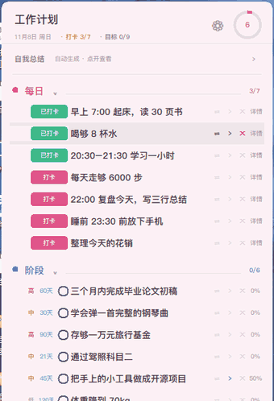
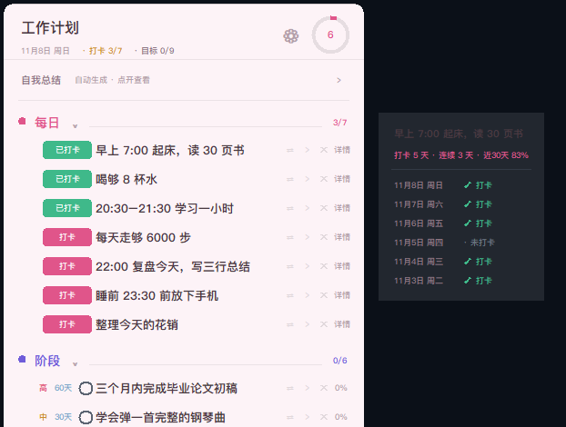
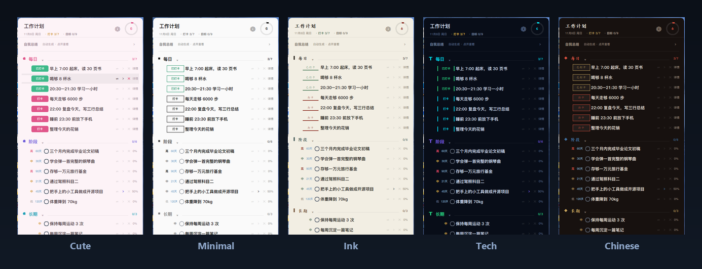

<div align="center">

# desktop-plan-widget · 桌面部件小计划

**Plan Card** — a Windows desktop plan widget. Frameless, always visible on your
wallpaper, never covers your work.




*Every frame above is the real app — check in, self-review, then three of the five themes.*

[Quick start](#quick-start) · [Why](#why-this-exists) · [Sections](#the-four-sections) · [Themes](#themes) · [FAQ](#faq) · [中文](#中文)

</div>

---

## Why this exists

Your plan is usually in an app you have to *remember to open*. That makes it the
last thing you look at, not the first.

Plan Card is the opposite bet: **make the plan impossible to miss, and impossible
to be annoyed by.** It sits on the wallpaper, below every other window — no title
bar, no taskbar entry, no notification, no popup. You see it in passing, and
nothing you're working on gets covered.

It is deliberately **not** a task manager: no projects, no tags, no reminders, no
account, no sync. Four kinds of plans, one JSON file, done.

## Quick start

```powershell
git clone https://github.com/1072699644-cell/desktop-plan-widget.git
cd desktop-plan-widget
python plan_card.pyw
```

No `pip install` — standard library only, so a stock **Python 3.8+** on **Windows
10/11** is all you need. Prefer no terminal? **Download the ZIP** and double-click
`plan_card.pyw`.

First launch seeds sample plans (English or Chinese, matching your system
language) so the card isn't empty — edit or delete them. Data lands in
`plan_data.json` next to the script; delete that file to start over.

## The four sections

They are separate because they **behave** differently — that's the whole design.

| | Section | For | Behaviour | In the ring? |
|:-:|---|---|---|:-:|
| 🟡 | **Daily** | today's habits | one **Check in** button per row; the list resets each morning, the history doesn't | ❌ |
| 🔵 | **Stage** | goals with a deadline | click the date chip → calendar; the row shows `12d` / `Today` / `3d late` | ✅ |
| 🟣 | **Long-term** | ongoing things | progress percentage, no deadline | ✅ |
| 🟢 | **Future** | someday / maybe | a plain list, no percentages | ❌ |

The progress ring counts **Stage + Long-term only** — the two sections where a
percentage means something. Daily is a routine; Future is a parking lot.

## Check-ins that remember

Every click is recorded, so a habit has a past — not just a checkbox.



- **check-ins** — total days you did it
- **streak** — consecutive days ending today (or yesterday, if today isn't done)
- **% in 30d** — how much of the last month you kept it

Each daily plan keeps a stable internal ID across days, which is why the history
survives the morning reset. The **self-review** at the top is generated from the
same data — you never write it. Collapsed it's one line; expand it for days
logged, check-ins, daily average and best streak, by day / week / month.

## Themes

Five themes. Each one also swaps the **font, the button shape and the section
marker** — a palette change alone would just look like the same app in a
different colour.



| Theme | Palette | Buttons | Markers |
|---|---|---|---|
| **Cute** | pale pink, pastel sections | rounded filled pill | circle |
| **Minimal** | near-white, greyscale | 1 px square outline | small square |
| **Ink** | rice paper, 楷体 | text + a brush stroke | vertical bar |
| **Tech** | deep navy, neon | double brackets `│x│` | diagonal tick |
| **Chinese** | dark lacquer, 国色 | seal-style outlined box | diamond |

## Compared to

| | Plan Card | Task app | Rainmeter skin | Sticky note |
|---|:---:|:---:|:---:|:---:|
| Visible without opening anything | ✅ | ❌ | ✅ | ✅ |
| Never covers your windows | ✅ | — | depends | ❌ |
| Four plan types, each with its own logic | ✅ | ✅ | ❌ | ❌ |
| Runs on a stock Python, no install | ✅ | ❌ | ❌ | — |
| Check-in history / streaks / auto self-review | ✅ | ✅ | ❌ | ❌ |
| Data in one local file | ✅ | ❌ | ✅ | ✅ |

## Features

**Planning**
- Daily check-in with memory — streaks and a 30-day rate.
- Calendar deadline picker for stage goals; no typing dates, ever.
- Sub-tasks, per-item priority, drag to reorder.
- Move any plan between sections: `⇄` menu, or drag the row onto another one.
- Fold a section by clicking its name; the state is remembered.

**Overview**
- Auto self-review: days logged, check-ins, daily average, best streak, goals.
- Progress ring, per-section counters, a thin scroll indicator when needed.
- The input box is always pinned to the bottom — it can never be pushed off.

**Looks**
- Five themes with their own fonts, button shapes and markers.
- Opacity from 30 % to 100 %, adjustable live.
- Renameable title. Bilingual UI (中文 / English) following the system language.

**Engineering**
- Zero third-party dependencies: one `.pyw` plus a small `tools/` folder.
- One JSON file — no account, no sync, no telemetry, **no network code**.
- Crash log only (`plan_card.log`); nothing is uploaded anywhere.

## Everyday controls

| Action | How |
|---|---|
| Add a plan | type in the bottom box, press `Enter` |
| Pick the target section | click the small chip left of the input box |
| Check in (daily) | click **Check in** |
| Edit text | **double-click** the row |
| Delete | `✕` at the right (appears on hover) |
| Reorder / move | drag a row, or `⇄` to switch section |
| Sub-tasks | `›` at the right |
| Deadline (stage) | click the `date` chip → calendar |
| Settings | ⚙ at the top right |

## FAQ

**Does it sync between machines?**
No. There's one `plan_data.json` — copy it yourself if you want to move.

**macOS / Linux?**
Not supported. The frameless, rounded, translucent window leans on Win32
(`SetWindowRgn`, layered windows); a port would need a different window layer.

**Does it phone home?**
There is no network code in this repository at all.

**Does it start with Windows?**
Not by itself. Put a shortcut in `shell:startup` — [Usage](docs/Usage.md) shows how.

**Can I add my own theme or language?**
Yes, both are small and documented in [CONTRIBUTING](CONTRIBUTING.md): a theme is
one dict, a language is one dictionary.

**Why are the JSON keys in Chinese?**
So that switching the interface language never touches your data — no migration,
no lost plans. Only the UI is translated, via `tools/i18n.py`.

**Is it a task manager?**
No, on purpose. If you need projects, tags, sharing or reminders this is the
wrong tool — and it will stay that way. [Architecture](docs/Architecture.md)
explains each trade-off.

## Good to know

- **Windows only**, tuned for 100 % display scaling at 1080p.
- **No installer** — it's a Python script; nothing is registered in the registry.
- Deleting `plan_data.json` resets everything (the sample plans come back).

## Docs

| | |
|---|---|
| [Usage](docs/Usage.md) | full English manual — every control, settings, troubleshooting |
| [使用说明](docs/使用说明.md) | 中文完整说明书 |
| [Architecture](docs/Architecture.md) | how it's built: Win32 window tricks, data model, check-in IDs, theme engine |
| [CONTRIBUTING](CONTRIBUTING.md) | add a theme, add a language, code layout |
| [CHANGELOG](CHANGELOG.md) | release notes |

## About

A small personal tool that got out of hand — it exists because my plans kept
dying in a notes app I had to remember to open.

- **One person, no company.** No team, no roadmap meetings, no analytics.
- **Local by design.** No account, no cloud, no telemetry, no network code.
- **Small on purpose.** Standard library only.
- **Feedback welcome.** Open an issue; I read all of them.
- **Contact.** 1072699644 `[at]` qq.com — issues are preferred for bugs and
  feature requests; email me for anything else.

⭐ If it saves you a minute a day, a star helps the next person find it.

## License

MIT — see [LICENSE](LICENSE).

---

<div align="center" id="中文">

# desktop-plan-widget · 桌面部件小计划

**一张贴在 Windows 桌面上的计划卡片——无边框、一直看得见、不挡任何窗口。**


[快速开始](#快速开始) · [为什么](#为什么做这个) · [四段计划](#四段计划) · [主题](#主题) · [常见问题](#常见问题) · [完整说明](docs/使用说明.md)

</div>

### 为什么做这个

计划写在备忘录里，最尴尬的地方是——**你得先想起来打开它**。结果它永远是你一天里
最后才看一眼的东西，而不是最先看到的。

Plan Card 反过来：**让计划躲不开，又不烦人。** 它贴在壁纸上、沉在所有窗口下面，
没有标题栏、不占任务栏、不弹通知。你路过就看见，同时什么都不会被挡住。

它刻意**不是**一个任务管理器：没有项目、没有标签、没有提醒、没有账号、没有同步。
四段计划，一个 JSON 文件，就这样。

### 快速开始

```powershell
git clone https://github.com/1072699644-cell/desktop-plan-widget.git
cd desktop-plan-widget
python plan_card.pyw
```

不需要 `pip install`，只用标准库。**Windows 10/11 + Python 3.8+** 即可。
不想用命令行就**下载 ZIP**，双击 `plan_card.pyw`。

第一次启动会按系统语言载入中文或英文示例计划。数据写在同目录的 `plan_data.json`，
删掉它就重来。

### 四段计划

四段是因为它们**行为不一样**，这才是设计的核心。

| | 段落 | 用途 | 行为 | 计入进度环 |
|:-:|---|---|---|:-:|
| 🟡 | **每日** | 今天的习惯 | 每行一个「打卡」按钮；清单每天早上重置，记录不会 | ❌ |
| 🔵 | **阶段** | 有期限的目标 | 点「期限」弹日历；行内显示 `剩 12 天` / `今天` / `逾期 3 天` | ✅ |
| 🟣 | **长期** | 长期要做的事 | 完成百分比，不设期限 | ✅ |
| 🟢 | **未来** | 以后想做的 | 纯清单，没有百分比 | ❌ |

进度环**只统计阶段 + 长期**（有百分比的那两段）；每日是打卡流程，未来是暂存区。

### 打卡是有记忆的

每一次点击都会被记录，所以一个习惯有过去，而不只是一个勾。


- **打卡 N 天** —— 累计做到的天数
- **连续 N 天** —— 从今天往前连着做了几天（今天还没做就从昨天数）
- **近 30 天 %** —— 最近一个月保持了多久

每条每日计划内部都有**跨天不变的 ID**，所以每天早上清单重置之后，历史仍然挂着。
顶部的**自我总结**也来自同一份数据，你一个字都不用写——收起是一行，展开看有记录天数、
打卡次数、日均完成和最长连续，可切日 / 周 / 月。

### 主题


五套主题，每一套连**字体、按钮形态、段标识**都换掉——只换颜色的话，看起来就只是同一个
软件换了个色号。

| 主题 | 配色 | 打卡按钮 | 段标识 |
|---|---|---|---|
| **可爱** | 淡粉、马卡龙四色 | 圆角药丸实心 | 圆点 |
| **极简** | 近白、全灰阶 | 1px 直角空心框 | 小方块 |
| **水墨** | 宣纸、楷体 | 文字 + 一道墨线 | 竖墨条 |
| **科技** | 深空、霓虹 | 双括号 `│打卡│` | 斜刻度 |
| **中式** | 乌木、国色、楷体 | 印章式描边框 | 菱形 |

### 特性速览

- **打卡带记忆**：连续天数、近 30 天打卡率、逐日时间详情
- **自动自我总结**：日 / 周 / 月，不用手写
- **日历选期限**：不用手打日期
- **子计划、重要性、拖动排序、拖拽换分类、段可收起**
- **透明度 30%–100%**、**标题可改名**、**中英双语界面**（跟随系统语言）
- **零第三方依赖、单文件、数据本地、没有联网代码**

### 常用操作

| 做什么 | 怎么做 |
|---|---|
| 加一条计划 | 底部输入框写，回车 |
| 选加进哪一段 | 点输入框左边的小胶囊 |
| 每日打卡 | 点 **打卡** |
| 改文字 | 行上**双击** |
| 删除 | 点行尾 `✕`（鼠标移上去才出现） |
| 排序 / 换分类 | 拖行，或点 `⇄` |
| 子计划 | 点行尾 `›` |
| 设期限（阶段） | 点「期限」→ 日历 |
| 设置 | 右上角 ⚙ |

### 常见问题

**会同步到别的电脑吗？**
不会。只有一个 `plan_data.json`，想搬就自己拷过去。

**支持 macOS / Linux 吗？**
不支持。无边框圆角半透明依赖 Win32（`SetWindowRgn`、分层窗口），换系统要换掉整个窗口层。

**会联网吗？**
这个仓库里没有任何联网代码。

**会开机自启吗？**
不会。想自启就把快捷方式放进 `shell:startup`，见[使用说明](docs/使用说明.md)。

**能自己加主题或语言吗？**
可以，都很小：[CONTRIBUTING](CONTRIBUTING.md) 里写了加一套主题（一个字典）
和加一门语言（一个词典）的步骤。

**JSON 里的键为什么是中文？**
为了切换界面语言时**不动你的数据**——不用迁移、不会丢计划。只有界面文字会被翻译。

### 需要知道的

- **只支持 Windows**，按 1080p / 100% 缩放调校
- **没有安装程序**——它就是个 Python 脚本，不写注册表、不进任务栏
- 删掉 `plan_data.json` 就是彻底重置（示例计划会回来）

完整说明：[docs/使用说明.md](docs/使用说明.md) ·
技术实现：[docs/Architecture.md](docs/Architecture.md)

⭐ 如果它每天帮你省下一分钟，给个 star 能让下一个需要它的人找到。
